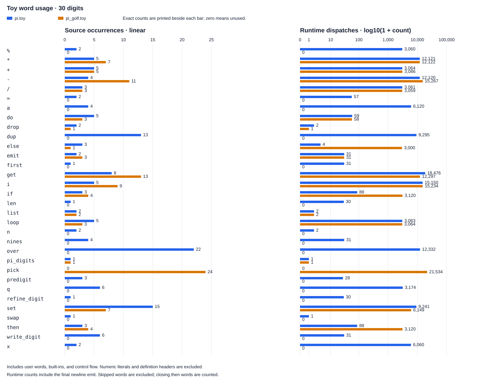

Generate the Pi comparison at 30 digits from the project root:

```sh
make profile
```

Results: [pi.toy](pi.profile.txt), [pi_golf.toy](pi_golf.profile.txt),
and [word counts as CSV](pi_usage.csv).

Use `./toyforth -p program.toy` or `--profile` for another program. Reports
go to stderr: word, calls, total elapsed milliseconds, and average microseconds.
Timing uses the POSIX monotonic clock: elapsed time includes waiting and is
unaffected by system-clock jumps. Timer resolution and profiling overhead
limit measurements of short words.

Times are inclusive (cumulative): user-defined words include their callees.
Results are aggregated per symbol across all callers; the profiler does not
record call hierarchy or self (exclusive) time. Nested and recursive calls
overlap, so adding row totals does not give the program's elapsed time.

`profile_pi.py` counts source words and combines the native reports into
the table and chart below. Counts include operators and control words;
source counts exclude literals and definition headers. Runtime counts
include only dispatched words, so skipped code and jump targets are excluded.

<!-- pi-usage:start -->



| Word | Kind | Source: pi | Source: golf | Runtime: pi | Runtime: golf |
| --- | --- | ---: | ---: | ---: | ---: |
| `%` | builtin | 2 | 0 | 3,060 | 0 |
| `*` | builtin | 5 | 7 | 12,121 | 12,122 |
| `+` | builtin | 5 | 5 | 3,064 | 3,086 |
| `-` | builtin | 4 | 11 | 12,120 | 15,267 |
| `/` | builtin | 3 | 3 | 3,061 | 3,059 |
| `=` | builtin | 2 | 0 | 57 | 0 |
| `a` | defined | 4 | 0 | 6,120 | 0 |
| `do` | control | 5 | 3 | 59 | 58 |
| `drop` | builtin | 2 | 1 | 2 | 1 |
| `dup` | builtin | 13 | 0 | 9,295 | 0 |
| `else` | control | 3 | 1 | 4 | 3,000 |
| `emit` | builtin | 2 | 3 | 31 | 31 |
| `first` | defined | 1 | 0 | 31 | 0 |
| `get` | builtin | 8 | 13 | 18,476 | 12,297 |
| `i` | control | 5 | 9 | 15,150 | 15,234 |
| `if` | control | 3 | 4 | 88 | 3,120 |
| `len` | builtin | 1 | 0 | 30 | 0 |
| `list` | builtin | 2 | 2 | 2 | 2 |
| `loop` | control | 5 | 3 | 3,063 | 3,064 |
| `n` | defined | 2 | 0 | 2 | 0 |
| `nines` | defined | 4 | 0 | 31 | 0 |
| `over` | builtin | 22 | 0 | 12,332 | 0 |
| `pi_digits` | defined | 1 | 1 | 1 | 1 |
| `pick` | builtin | 0 | 24 | 0 | 21,534 |
| `predigit` | defined | 3 | 0 | 28 | 0 |
| `q` | defined | 6 | 0 | 3,174 | 0 |
| `refine_digit` | defined | 1 | 0 | 30 | 0 |
| `set` | builtin | 15 | 7 | 9,241 | 6,149 |
| `swap` | builtin | 1 | 0 | 1 | 0 |
| `then` | control | 3 | 4 | 84 | 115 |
| `write_digit` | defined | 6 | 0 | 31 | 0 |
| `x` | defined | 2 | 0 | 6,060 | 0 |
| **Total** | | 141 | 101 | 116,849 | 98,140 |

<!-- pi-usage:end -->
